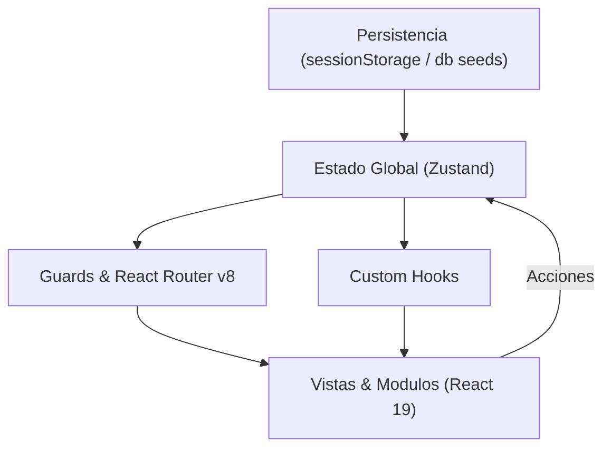

# Mangateca

Mangateca es una aplicacion web de comercio electronico para el catalogo y venta de libros, mangas y comics. Opera bajo una arquitectura Single Page Application (SPA) client-side first que combina persistencia en sesion con sincronizacion reactiva, navegacion indexada a la URL y estandares de accesibilidad WCAG AA.

Para una revision exhaustiva archivo por archivo, diseno tecnico detallado y analisis de flujos del sistema, consultar docs/doc.md.

---

## Arquitectura

El sistema implementa un flujo unidireccional desacoplado entre persistencia, estado global, adaptadores y vistas:

### Principios Tecnicos

- **Client-Side First con Persistencia:** Hidratacion inicial desde datos semilla JSON (`db/`) y sincronizacion en `sessionStorage` mediante middleware de Zustand, permitiendo operatividad completa sin backend en tiempo real.
- **Sesion Ligera y RBAC:** `authStore` persiste unicamente `currentUserId`. La resolucion de identidad y privilegios se procesa en tiempo de ejecucion mediante hooks para asegurar consistencia de roles.
- **Deep Linking y Estado en URL:** Busquedas, filtros, ordenamiento y apertura de fichas tecnicas (`?producto=ID`) se controlan mediante parametros de consulta, preservando el historial del navegador.
- **Estandares Web Modernos:** Uso de `<dialog>` nativo para modales con captura de foco y API HTML Popover (`popover="manual"`) en notificaciones para renderizado en el Top Layer del navegador.
- **Carga Diferida:** Division de codigo dinamica en las rutas del panel administrativo para optimizar el bundle de cliente.

---

## Stack Tecnologico y Dependencias

| Categoria | Tecnologia | Version | Rol |
| :--- | :--- | :--- | :--- |
| Core | React | `^19.2.8` | Biblioteca de UI, Actions (`useActionState`) y metadatos nativos |
| Routing | React Router | `^8.4.0` | Enrutamiento SPA, layouts anidados y guardas de navegacion |
| Estado | Zustand | `^5.0.15` | Estado global atomico con persistencia en `sessionStorage` |
| Estilos | Tailwind CSS | `^4.3.3` | Utilidades CSS basadas en directivas `@theme` |
| Build Tool | Vite | `^8.3.0` | Servidor de desarrollo rapido y empaquetador para produccion |
| Testing | Vitest | `^5.0.5` | Motor de pruebas unitarias y de integracion |
| Testing | Testing Library | `^16.3.3` | Pruebas de interaccion en DOM enfocadas en el usuario |
| Linter | ESLint | `^10.10.0` | Analisis estatico con configuracion plana (Flat Config) |

---

## Scripts del Proyecto

| Comando | Descripcion |
| :--- | :--- |
| `npm run dev` | Inicia el entorno local de desarrollo con recarga rapida |
| `npm run build` | Genera la compilacion optimizada para produccion en `dist/` |
| `npm run preview` | Previsualiza localmente el build de produccion |
| `npm run test:run` | Ejecuta la suite de pruebas automatizadas |
| `npm run test:coverage` | Genera el informe de cobertura de codigo con motor V8 |
| `npm run lint` | Valida el codigo con las reglas estaticas de ESLint |

---

## Usuarios de Demostracion

Cuentas precargadas para evaluar los niveles de acceso y roles del sistema:

| Rol | Usuario | Correo | Contrasena |
| :--- | :--- | :--- | :--- |
| Administrador | `admin` | `admin@mangateca.com` | `Demo1234` |
| Cliente | `cliente` | `cliente@mangateca.com` | `Demo1234` |
