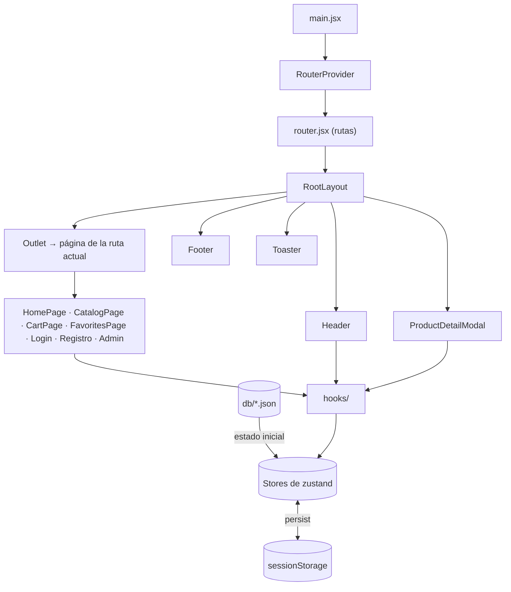

# Mangateca

Tienda online de **libros, mangas y cómics** construida como una SPA (Single Page Application) con React y Tailwind CSS.

Es un proyecto **sin backend**: el catálogo y los usuarios salen de archivos JSON (`db/`), y todo lo que cambia (sesión, carrito, favoritos, ediciones del admin) se guarda en el `sessionStorage` del navegador. Sirve para practicar y demostrar el frontend completo de una tienda: navegación, búsqueda, carrito, autenticación con roles y un panel de administración CRUD. Las compras son simuladas.

---

## Índice

1. [Funcionalidades](#funcionalidades)
2. [Tecnologías](#tecnologías)
3. [Puesta en marcha](#puesta-en-marcha)
4. [Estructura del proyecto](#estructura-del-proyecto)
5. [Arquitectura](#arquitectura)
6. [Rutas y permisos](#rutas-y-permisos)
7. [Estado global y persistencia](#estado-global-y-persistencia)
8. [Datos simulados](#datos-simulados)
9. [Funcionalidades en detalle](#funcionalidades-en-detalle)
10. [Diseño y accesibilidad](#diseño-y-accesibilidad)
11. [Decisiones técnicas](#decisiones-técnicas)
12. [Limitaciones](#limitaciones)
13. [Cómo extender el proyecto](#cómo-extender-el-proyecto)

---

## Funcionalidades

- **Portada** con buscador en tiempo real y tres carruseles: *Novedades*, *Más vendidos* y *Recomendados*.
- **Catálogo** completo y por tipo (Libros, Mangas, Cómics), con filtro por categoría, búsqueda y orden.
- **Detalle de producto** en una tarjeta modal: portada, categorías, título, autor, precio, sinopsis, ISBN, fecha de publicación y disponibilidad.
- **Carrito de compras** con cantidades, totales y una compra simulada.
- **Favoritos** por usuario.
- **Registro e inicio de sesión** con tres tipos de usuario: invitado, registrado (cliente) y administrador.
- **Panel de administración** para crear, editar y eliminar productos y usuarios.
- **Diseño responsive**: escritorio, tablet y móvil (con menú hamburguesa).

## Tecnologías

| Tecnología | Versión | Uso |
|---|---|---|
| [React](https://react.dev) | 19 | Interfaz de usuario |
| [React Router](https://reactrouter.com) | 8 | Navegación (modo datos) |
| [Zustand](https://zustand.docs.pmnd.rs) | 5 | Estado global y persistencia |
| [Tailwind CSS](https://tailwindcss.com) | 4 | Estilos |
| [Vite](https://vite.dev) | 8 | Servidor de desarrollo y build |
| ESLint | 10 | Calidad de código (reglas de hooks y Fast Refresh) |

No hay más dependencias: los iconos son SVG en línea y el carrusel, los modales y las notificaciones están hechos con APIs nativas del navegador.

## Puesta en marcha

**Requisitos:** Node.js 22.22 o superior (lo exige React Router 8) y npm.

```bash
npm install       # instalar dependencias
npm run dev       # servidor de desarrollo → http://localhost:5173
npm run build     # build de producción en dist/
npm run preview   # sirve el build de producción
npm run lint      # revisa el código con ESLint
```

### Cuentas de prueba

| Rol | Usuario | Contraseña |
|---|---|---|
| Administrador | `admin` | `Admin_Manga2026!` |
| Cliente | `cliente` | `Cliente_Manga2026!` |

También se puede iniciar sesión con el email (`admin@mangateca.com`, `cliente@mangateca.com`) o crear una cuenta nueva desde **Registro**.

## Estructura del proyecto

```
mangateca-project/
├── db/                         # Datos simulados (semilla)
│   ├── products.json           # 36 productos: 15 libros, 9 mangas, 12 cómics
│   ├── categories.json         # 17 categorías
│   └── users.json              # Usuarios iniciales (admin y cliente)
├── public/
│   └── favicon.svg             # Logo de Mangateca
├── index.html
└── src/
    ├── main.jsx                # Punto de entrada: monta el router
    ├── router.jsx              # Definición de todas las rutas
    ├── style.css               # Tailwind + tokens de color de la marca
    ├── data/                   # Datos estáticos de la app
    │   ├── catalog.js          # Tipos de producto y categorías
    │   ├── featured.js         # Selección de Más vendidos y Recomendados
    │   └── navigation.js       # Enlaces del menú (Header y Footer)
    ├── lib/                    # Funciones puras, sin React
    │   ├── storage.js          # Dónde se persisten los stores (sessionStorage)
    │   ├── search.js           # Normalización y búsqueda de productos
    │   ├── validation.js       # Validación de formularios
    │   ├── format.js           # Formato de precios y fechas
    │   └── cn.js               # Utilidad para unir clases CSS
    ├── stores/                 # Estado global (zustand)
    │   ├── productsStore.js
    │   ├── usersStore.js
    │   ├── authStore.js
    │   ├── cartStore.js
    │   ├── favoritesStore.js
    │   └── toastStore.js
    ├── hooks/                  # Hooks reutilizables
    │   ├── useCurrentUser.js   # Usuario en sesión y su rol
    │   ├── useProductModal.js  # Abrir/cerrar el detalle vía URL
    │   ├── useFavorites.js     # Favorito de un producto / lista de favoritos
    │   ├── useCart.js          # Líneas, unidades y total del carrito
    │   └── useDismiss.js       # Cerrar al hacer clic fuera o pulsar Esc
    ├── components/
    │   ├── layout/             # RootLayout, Header, Footer, Container, errores y carga
    │   ├── product/            # Tarjeta, carrusel, grid, portada, modal de detalle, botones
    │   ├── search/             # Buscador con panel de resultados
    │   ├── auth/               # Guards de rutas y marco de login/registro
    │   ├── ui/                 # Botón, modal, diálogo de confirmación, campos, toasts…
    │   └── icons/              # Iconos SVG como componentes
    └── pages/
        ├── HomePage.jsx
        ├── CatalogPage.jsx
        ├── CartPage.jsx
        ├── FavoritesPage.jsx
        ├── LoginPage.jsx
        ├── RegisterPage.jsx
        ├── NotFoundPage.jsx
        └── admin/              # Panel de administración (se carga bajo demanda)
            ├── AdminLayout.jsx
            ├── AdminProductsPage.jsx
            ├── AdminUsersPage.jsx
            ├── ProductForm.jsx
            └── UserForm.jsx
```

**Regla general:** `lib/` y `data/` no dependen de React; `stores/` guarda el estado; `hooks/` combina stores para los componentes; `components/` son piezas reutilizables; `pages/` son las pantallas de cada ruta.

## Arquitectura



### Flujo de arranque

1. `index.html` carga `src/main.jsx`.
2. `main.jsx` importa los estilos y renderiza `<RouterProvider router={router} />`.
3. `router.jsx` define el árbol de rutas. La ruta raíz usa `RootLayout`.
4. `RootLayout` dibuja lo común a todas las páginas: Header, contenido (`<Outlet />`), Footer, el modal de detalle de producto y las notificaciones.
5. Al cargar, cada store de zustand lee su estado de `sessionStorage`. Si está vacío, parte de los datos de `db/`.

> **¿Por qué no hay `App.jsx`?** En el modo datos de React Router, el componente raíz es el router. El papel de "App" (la estructura común) lo cumple `RootLayout`, que tiene que ser una ruta para poder usar hooks del router (`NavLink`, `useNavigate`, `useSearchParams`) y funciones como `ScrollRestoration`. El router se crea fuera de cualquier componente, como recomienda la documentación, para que no se recree en cada render. Zustand no necesita providers, así que no hay nada que envolver.

## Rutas y permisos

| Ruta | Página | Acceso |
|---|---|---|
| `/` | Portada | Todos |
| `/productos` | Catálogo completo | Todos |
| `/libros`, `/mangas`, `/comics` | Catálogo por tipo | Todos |
| `/carrito` | Carrito | Todos |
| `/favoritos` | Mis favoritos | Con sesión |
| `/login`, `/registro` | Inicio de sesión y registro | Solo invitados |
| `/admin/productos` | CRUD de productos | Solo administradores |
| `/admin/usuarios` | CRUD de usuarios | Solo administradores |
| `*` | Página 404 | Todos |

Cualquier página acepta además `?producto=<id>`, que abre el detalle de ese producto encima.

### Guards (`src/components/auth/Guards.jsx`)

- **`RequireAuth`**: sin sesión, redirige a `/login` y guarda la página de origen.
- **`RequireAdmin`**: sin sesión, redirige a `/login`. Con sesión de cliente, redirige a la portada.
- **`GuestOnly`**: con sesión, redirige a la página de origen (o a la portada). Es el único lugar que decide adónde volver tras iniciar sesión o registrarse.

Los guards leen el store en cada render, así que reaccionan al instante: si un administrador cierra sesión estando en `/admin`, sale del panel inmediatamente.

### Qué puede hacer cada tipo de usuario

| Acción | Invitado | Cliente | Admin |
|---|:-:|:-:|:-:|
| Ver catálogo, buscar, ver detalle | ✅ | ✅ | ✅ |
| Agregar al carrito y "comprar" | ✅ | ✅ | ✅ |
| Guardar favoritos | ❌ → se le pide iniciar sesión | ✅ | ✅ |
| Panel de administración | ❌ | ❌ | ✅ |

## Estado global y persistencia

El estado global vive en **stores de zustand** (`src/stores/`). Cada store persistido usa el middleware `persist` con el almacenamiento definido en `src/lib/storage.js`:

```js
export const appStorage = createJSONStorage(() => sessionStorage)
```

| Store | Clave en sessionStorage | Contenido | Acciones |
|---|---|---|---|
| `productsStore` | `mangateca-products` | `products`, `lastId` | `addProduct`, `updateProduct`, `deleteProduct` |
| `usersStore` | `mangateca-users` | `users`, `lastId` | `findByCredentials`, `getConflicts`, `addUser`, `updateUser`, `deleteUser` |
| `authStore` | `mangateca-auth` | `currentUserId` | `login`, `register`, `logout` |
| `cartStore` | `mangateca-cart` | `items: [{ productId, quantity }]` | `addItem`, `setQuantity`, `removeItem`, `clear` |
| `favoritesStore` | `mangateca-favorites` | `byUser: { [userId]: productId[] }` | `toggle` |
| `toastStore` | — (no se persiste) | `toasts` | `toast(mensaje, variante)`, `dismiss` |

Puntos importantes:

- **`sessionStorage`** conserva los datos al recargar la página, pero se borra al cerrar la pestaña. Una pestaña nueva empieza con los datos de `db/`. Para que los datos duren entre sesiones, cambia `sessionStorage` por `localStorage` en `src/lib/storage.js`.
- **La sesión solo guarda el id del usuario** (`currentUserId`), nunca la contraseña. El usuario completo se obtiene de `usersStore` con el hook `useCurrentUser`, así que un cambio de rol hecho por el admin se aplica al instante.
- **`lastId` es un contador que solo crece**: si se elimina el producto 37, el siguiente producto nuevo será el 38. Así un carrito o favorito antiguo nunca apunta por error a otro producto.
- **Los productos eliminados desaparecen solos** del carrito y de favoritos: los hooks `useCart` y `useFavoriteProducts` descartan los ids que ya no existen.
- Cada store tiene `version: 1` para poder migrar el formato de los datos en el futuro.

## Datos simulados

Los archivos de `db/` son la **semilla**: el estado inicial de la tienda.

**Producto** (`db/products.json`):

```json
{
  "id": 1,
  "type": "BOOK",
  "title": "Cien años de soledad",
  "description": "Obra cumbre del realismo mágico…",
  "author": "Gabriel García Márquez",
  "isbn": "9780060883287",
  "publicationDate": "1967-06-05",
  "categoryIds": [1, 2],
  "price": 18.99,
  "available": true,
  "imageUrl": "https://covers.openlibrary.org/b/isbn/9780060883287-L.jpg"
}
```

- `type`: `BOOK`, `MANGA` o `COMIC` (sus nombres en pantalla están en `src/data/catalog.js`).
- `categoryIds`: ids de `db/categories.json`.
- `price`: en dólares (USD).

**Usuario** (`db/users.json`): `id`, `username`, `email`, `password`, `role` (`client` o `admin`) y `createdAt`.

**Categoría** (`db/categories.json`): `id` y `name`. Las categorías son fijas: el admin no las edita.

## Funcionalidades en detalle

### Portada (`HomePage`)

- **Novedades**: los 10 productos con el `id` más alto, es decir, los últimos añadidos. Un producto creado por el admin aparece aquí el primero.
- **Más vendidos** y **Recomendados**: selecciones curadas por id en `src/data/featured.js`.
- **Carrusel** (`ProductCarousel`): usa el desplazamiento nativo con `scroll-snap`, así que en móvil se desliza con el dedo. En escritorio tiene flechas que se desactivan al llegar a cada extremo.

### Buscador (`SearchBar`)

- Filtra **mientras escribes**, sin botón de buscar.
- Busca en título, autor e ISBN, **sin distinguir mayúsculas ni tildes** ("garcia" encuentra a "García Márquez"). Si escribes varias palabras, todas deben aparecer.
- Ordena primero los títulos que empiezan por lo buscado y después los que lo contienen.
- El panel muestra hasta 6 resultados y un enlace "Ver los N resultados" que lleva al catálogo filtrado (`/productos?q=…`).
- **Teclado**: ↑/↓ recorren los resultados, Enter abre el detalle y Esc cierra el panel. El panel también se cierra al hacer clic fuera.
- Usa `useDeferredValue` para que escribir siga siendo fluido aunque el filtrado tarde.

### Catálogo (`CatalogPage`)

Una misma página sirve para `/productos`, `/libros`, `/mangas` y `/comics`. Los filtros se guardan en la URL, así que se pueden compartir y sobreviven a recargar:

| Parámetro | Ejemplo | Efecto |
|---|---|---|
| `q` | `?q=alan moore` | Búsqueda por texto |
| `categoria` | `?categoria=9` | Filtra por categoría (solo se muestran las que tienen productos de ese tipo) |
| `orden` | `?orden=precio-asc` | `precio-asc`, `precio-desc`, `titulo`, `recientes` (por defecto: destacados) |

### Detalle de producto (`ProductDetailModal`)

- Se abre al pulsar una tarjeta, un resultado del buscador o una portada del carrito.
- Está montado una sola vez en `RootLayout` y se controla con el parámetro `?producto=<id>` de la URL (hook `useProductModal`). Por eso:
  - el enlace se puede compartir (`/mangas?producto=3` abre Berserk encima del catálogo de mangas);
  - el botón **Atrás** del navegador lo cierra;
  - también se cierra con Esc, con la ✕ o haciendo clic fuera.
- Desde el detalle se elige la cantidad, se agrega al carrito y se marca como favorito.
- Si `available` es `false`, el botón de compra aparece como "Agotado".

### Carrito (`CartPage`)

- Disponible para **todos**, también para invitados.
- Hay un solo carrito por pestaña. Si un invitado inicia sesión, conserva su carrito. Al cerrar sesión, el carrito se vacía.
- Cantidad entre 1 y 10 unidades por producto.
- Muestra subtotal, envío (gratis) y total.
- **Finalizar compra** pide confirmación, vacía el carrito y muestra un mensaje de éxito. No se cobra nada.

### Favoritos (`FavoritesPage`)

- Cada usuario tiene su propia lista.
- Si un **invitado** pulsa el corazón ♥, ve un aviso y se le lleva a iniciar sesión (con enlace a registro). Al terminar vuelve a la página donde estaba.
- El contador del Header muestra cuántos favoritos tienes.

### Registro e inicio de sesión

- **Login** con nombre de usuario o email (sin distinguir mayúsculas). Si falla, el mensaje es genérico ("Usuario o contraseña incorrectos") para no revelar qué dato era erróneo.
- **Registro** valida:
  - nombre de usuario de 3 a 20 caracteres (letras, números, `.`, `-`, `_`);
  - email con formato válido;
  - contraseña de al menos 8 caracteres y confirmación igual;
  - que el usuario y el email no existan ya.
- Un usuario registrado se crea con rol `client` y entra automáticamente.
- Los formularios usan `useActionState` de React 19. Si hay errores, conservan lo escrito (excepto las contraseñas).

### Panel de administración (`/admin`)

Solo accesible para administradores (enlace en el menú de usuario del Header). Se descarga **bajo demanda**: los clientes no reciben su código.

**Productos**
- Tabla con portada, título, autor, tipo, ISBN, precio y estado, más un buscador.
- Crear y editar en un formulario modal con vista previa de la portada.
- Validaciones: título, autor y sinopsis obligatorios; ISBN de 10 o 13 dígitos; fecha de publicación; precio mayor que 0; al menos una categoría; URL de portada `http` o `https`.
- Eliminar pide confirmación.

**Usuarios**
- Tabla con usuario, email, rol y fecha de alta.
- Crear, editar (la contraseña es opcional: si se deja vacía, se mantiene) y eliminar.
- Reglas de seguridad:
  - un administrador **no puede eliminarse a sí mismo** ni **quitarse su propio rol**;
  - siempre debe quedar **al menos un administrador**;
  - el nombre de usuario y el email deben ser únicos.

## Diseño y accesibilidad

### Identidad visual

- Diseño minimalista y moderno, con fondo blanco.
- Logo: `public/favicon.svg`.
- Color representativo: **`#4FB59B`**. Los tokens están en `src/style.css`:

| Token | Color | Uso |
|---|---|---|
| `brand-50` / `brand-100` | `#EEF8F5` / `#D5EFE7` | Fondos suaves (hero, chips) |
| `brand-500` | `#4FB59B` | Acentos, iconos, indicadores, anillo de foco |
| `brand-700` | `#2E7D69` | Botones principales, enlaces, navegación activa, precios |
| `coral-500` | `#E85D5D` | Favoritos (tomado del destello del logo) |

> El texto blanco sobre `#4FB59B` tiene un contraste de ~2.5:1, insuficiente según WCAG AA (mínimo 4.5:1). Por eso los botones con texto blanco usan `brand-700` (~4.9:1).

### Accesibilidad

- HTML semántico (`header`, `nav`, `main`, `footer`, `section`, `dl`) y enlace "Saltar al contenido".
- Todos los botones de solo icono tienen `aria-label`. El de favorito usa `aria-pressed`.
- El buscador sigue el patrón **combobox** de ARIA (`role="combobox"`, `listbox`, `option`, `aria-activedescendant`).
- Los modales usan el elemento nativo `<dialog>`, que atrapa el foco y se cierra con Esc.
- Los campos de formulario tienen `label` asociado y anuncian sus errores (`aria-invalid`, `aria-describedby`).
- Foco visible en toda la app con el color de la marca.
- El carrusel respeta `prefers-reduced-motion`.

## Decisiones técnicas

| Decisión | Motivo |
|---|---|
| React Router en **modo datos** (`createBrowserRouter`) | Permite carga diferida del admin, restauración del scroll y manejo de errores por ruta. En v8, `RouterProvider` se importa de `react-router/dom`. |
| **Zustand** para el estado | Stores pequeños, sin providers y con persistencia incluida (`persist`). |
| Selectores que devuelven primitivos o referencias estables | En zustand v5, un selector que crea un array nuevo en cada render provoca bucles. Los arrays derivados se calculan con `useMemo` y las listas vacías usan una constante (`NO_FAVORITES`). |
| Detalle de producto en la **URL** | Enlaces compartibles y el botón Atrás funciona como espera el usuario. |
| **`<dialog>` nativo** para modales | Foco atrapado, Esc y capa superior sin librerías. |
| Notificaciones en un **`popover`** | El popover entra en la *top layer* del navegador, así que los avisos se ven por encima de un modal abierto. |
| **`useActionState`** en formularios | Patrón recomendado en React 19 para formularios. La acción devuelve los valores enviados para que el formulario no se vacíe al mostrar errores. |
| **`useDeferredValue`** en búsquedas | La escritura no se bloquea mientras se filtra. |
| **`useEffectEvent`** en `useDismiss` | El listener siempre llama a la versión actual del callback sin volver a suscribirse. |
| **`<title>` dentro de cada página** | React 19 lo mueve al `<head>` automáticamente. |
| Cerrar sesión con `navigate('/', { flushSync: true })` **antes** de `logout()` | Si se cerrara la sesión primero, el guard de la página protegida (favoritos, admin) redirigiría a `/login` en vez de a la portada. `flushSync` hace que la navegación se aplique al instante (por defecto React Router la aplica en una transición). |
| Iconos SVG propios | Sin dependencias y con `currentColor` para heredar el color del texto. |

## Limitaciones

- **No hay backend**: los datos solo existen en el navegador de cada usuario.
- **Las contraseñas se guardan en texto plano** en `db/users.json` y en `sessionStorage`. Es aceptable solo por ser una simulación; en un proyecto real la autenticación debe hacerla un servidor.
- **Los datos se reinician al cerrar la pestaña** (por usar `sessionStorage`).
- **Las portadas se cargan desde sitios externos** (Open Library, MyAnimeList). Si una no carga, se muestra un recuadro con el título.
- **La compra es simulada**: no hay pasarela de pago, stock real ni pedidos.
- **Las categorías son fijas**: no tienen CRUD.
- **Las cuentas de prueba se muestran en la página de login** para facilitar la demostración. Conviene quitarlas si el sitio se publica.

## Cómo extender el proyecto

| Quiero… | Dónde |
|---|---|
| Cambiar los productos de *Más vendidos* o *Recomendados* | `src/data/featured.js` |
| Cambiar cuántos productos salen en *Novedades* | `NEW_RELEASES_LIMIT` en `src/data/featured.js` |
| Añadir un enlace al menú | `src/data/navigation.js` (lo usan el Header y el Footer) |
| Añadir una página | Crear el componente en `src/pages/` y registrarlo en `src/router.jsx` (dentro de `RequireAuth` o `RequireAdmin` si debe estar protegida) |
| Persistir datos entre sesiones | Cambiar `sessionStorage` por `localStorage` en `src/lib/storage.js` |
| Cambiar los colores de la marca | Tokens `--color-brand-*` en `src/style.css` |
| Cambiar las reglas de validación | `src/lib/validation.js` |
| Añadir un campo a los productos | `db/products.json`, el formulario `src/pages/admin/ProductForm.jsx` (`readProduct` y los campos) y donde se muestre (`ProductDetailModal`, `ProductCard`). Si cambia el formato de los datos guardados, sube la `version` del store. |
| Conectar un backend real | Sustituir las acciones de los stores (`addProduct`, `login`, etc.) por llamadas a la API, o cargar los datos con *loaders* de React Router. |
